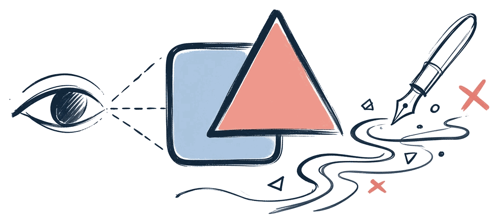
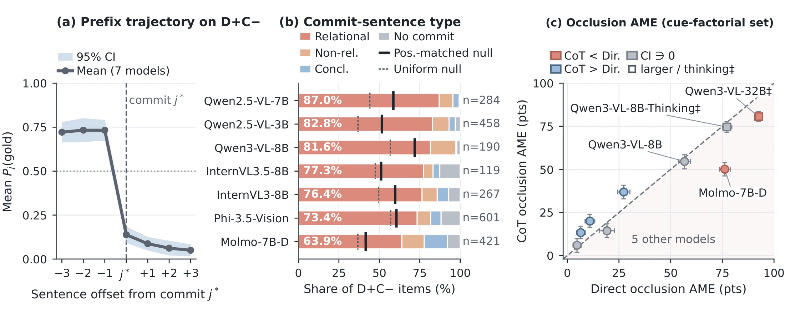
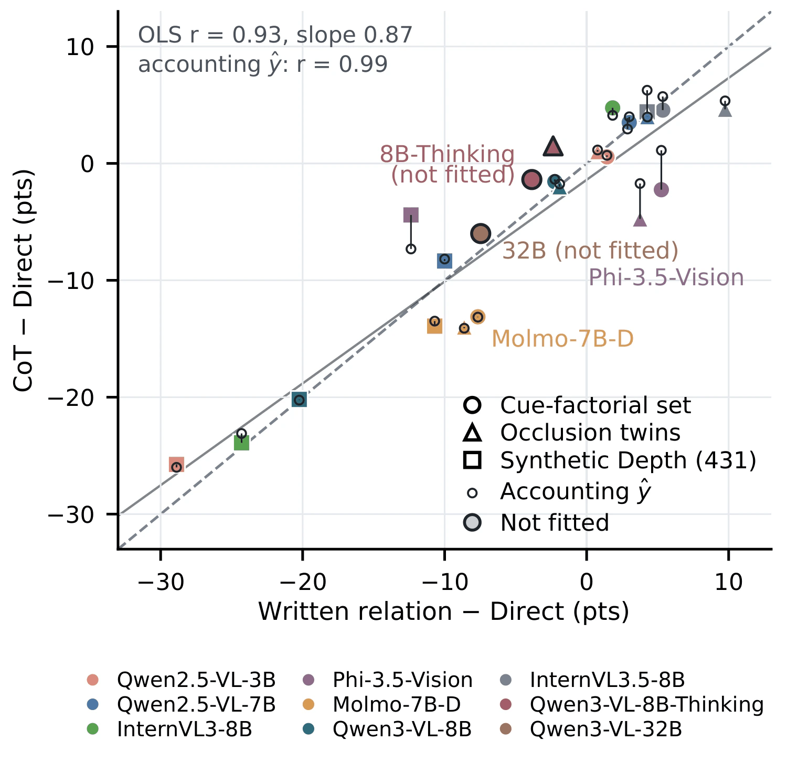
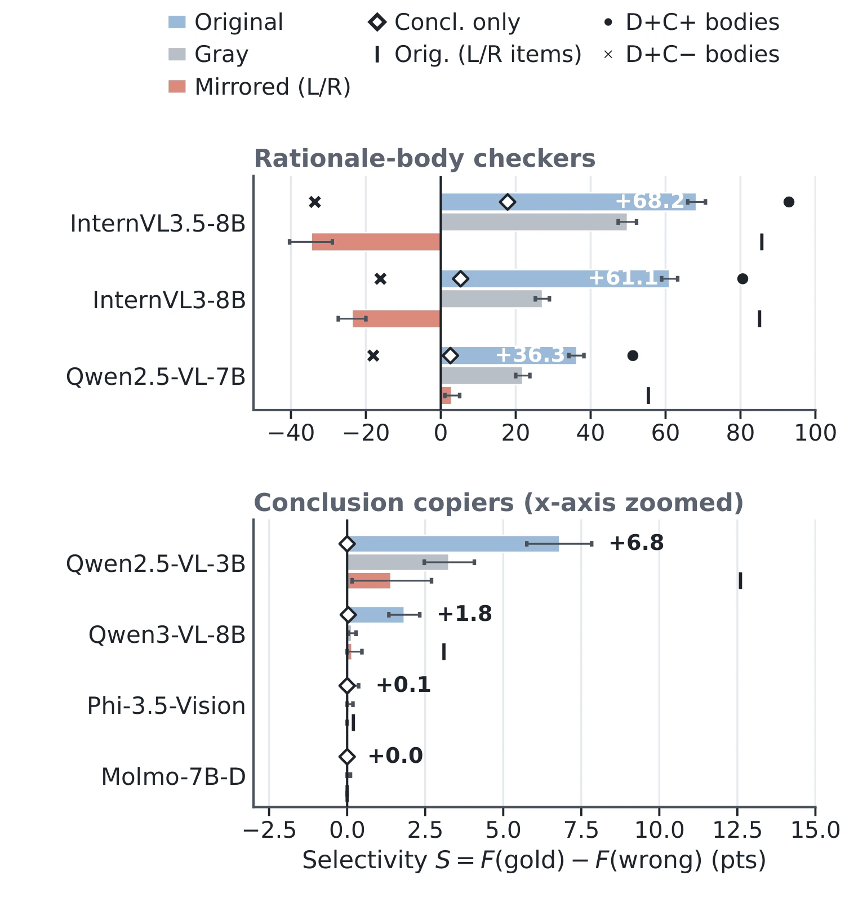

# Seeing Right, Writing Wrong

<div align="center">

**Where Short Chain-of-Thought Breaks Spatial VQA**

<p align="center">
  <a href="https://arxiv.org/abs/XXXX.XXXXX">
    
  </a>
  <a href="https://ming-zch.github.io/seeing-right-writing-wrong/">
    
  </a>
  <a href="LICENSE">
    
  </a>
</p>



</div>

---

## 🔥News

- **[Nov. 2026]**: Our paper is released on [arXiv](https://arxiv.org/abs/XXXX.XXXXX), check it out!
- **[Nov. 2026]**: Code, prompts, and per-item model outputs are released!

## ✨ Highlights

- 🔍 **Broad study**: 15 open VLMs (2B–38B) and 6 frontier closed models on binary depth and spatial questions. Short CoT significantly lowers accuracy in 6 of 8 main-pool open models, and rationale length, turn format and visual forgetting do not explain the drop.
- ✍️ **Writing re-weights visual cues**: 56.6% of the Direct-right, CoT-wrong losses on three occlusion sets end in a false written spatial relation.
- 🔒 **Text lock-in**: with the model's own conclusion-removed rationale held fixed, mirroring the photo moves the answer by only 3.4 pts, compared with 69.6 pts under Direct answering (7-model mean).
- 🔁 **Conclusions mis-map true relations**: 23.8% of these losses write a true relation and then pick the wrong option, mostly on converse questions (29.5% error vs. 2.4% on restatements).
- 📈 **When CoT helps**: the accuracy of the written relation relative to Direct tracks the net CoT effect (r = 0.93 across 21 model-by-dataset cells).
- 🧭 **Re-grounding**: 3 of 6 closed models re-check the image after writing (the three that lock in were queried with reasoning off), and a LoRA pilot suggests that answer-step re-grounding is learnable.

## 📋 Table of Contents

- [Introduction](#introduction)
- [Method](#method)
- [Getting Started](#getting-started)
  - [Installation](#installation)
  - [Quick Start (CPU)](#quick-start-cpu)
  - [Repository Layout](#repository-layout)
  - [Re-running the Experiments (GPU / API)](#re-running-the-experiments-gpu--api)
  - [Data Sources and Licences](#data-sources-and-licences)
- [Results](#results)
- [Citation](#citation)
- [Acknowledgments](#acknowledgments)

## Introduction

Asking a vision-language model (VLM) to think step by step often lowers its accuracy on spatial questions, even though the image stays in context. We show that short chain-of-thought (CoT) turns spatial VQA from a perception problem into a transcription problem: once a VLM writes a spatial relation, its answer follows that sentence rather than the image. The failure has three stages. (1) Writing re-weights visual cues and often yields a false relation. (2) Text lock-in: with the model's own conclusion-removed rationale fixed, swapping the image barely moves the answer. (3) Concluding sentences mis-map even true relations, mainly on converse questions. How accurate the written relation is compared with Direct answering accounts for when CoT helps and when it hurts.

<p align="center">
  
</p>

*(a) On occlusion twins, Direct answers flip with the image, while short CoT writes the same false relation for both images. (b) On Direct-right, CoT-wrong items, judges mark the first spatial claim as contradicting the image far more often than on items CoT gets right. (c) After writing, the image barely affects open models' answers, while some closed models re-check it.*

## Method

The analysis protocol measures where in the rationale the answer stops depending on the image.

- **Forced readout.** We read the higher-probability option letter at the assistant prefix `Answer: (`, either right after the question (**Direct**) or after a greedy step-by-step rationale (**CoT**). The same readout can be taken after every rationale sentence.
- **Conclusion-removed rationale (R<sub>cut</sub>).** The model's own rationale with its concluding answer sentence removed, so that only the body claims remain.
- **Image swaps.** Paired images that flip the correct answer and change nothing else: rendered **occlusion twins** (only the object in front changes), **COCO occlusion twins** (segmented natural objects with swapped paste order), and **mirrored photos** (horizontally flipped CV-Bench images for left/right questions). The **image effect** is the change in answer probability when the image is swapped while R<sub>cut</sub> stays fixed (100 pts: the answer follows the image; 0 pts: the image is ignored).
- **Commit sentence j\*.** The rationale sentence at which the forced-readout probability of the correct option drops below 0.5 and stays there until the end of the rationale.
- **Sentence judges.** Two LLM judges (Claude Opus 5.5 and GPT-6-Astra) label the spatial relation in each sentence as true or false, which separates false written relations from correct relations mapped to the wrong option.

<p align="center">
  
</p>

*(a) The forced readout stays high until the commit sentence j\* and then drops. (b) Most commit sentences state a spatial relation. (c) CoT changes how much the final answer relies on occlusion.*

## Getting Started

### Installation

The CPU analysis needs Python 3.11 and the pinned packages in `requirements.txt` (numpy, scipy, pandas, matplotlib, scikit-learn, statsmodels, pillow).

```bash
git clone https://github.com/MING-ZCH/seeing-right-writing-wrong.git
cd seeing-right-writing-wrong
python3.11 -m venv .venv && source .venv/bin/activate
pip install -r requirements.txt
```

### Quick Start (CPU)

Regenerate every table and figure from the shipped per-item outputs and compare them with the copies the paper was compiled from. No GPU, network, model or dataset is needed. The full run takes about 3 minutes on 4 CPU threads.

```bash
source env.example.sh               # sets VTAX_ROOT and the other paths (all inside the repository)
python tools/unpack_outputs.py      # decompress outputs/**/*.gz next to the .gz files
python tools/regen_tables.py        # run every table / figure generator, then tools/check_tables.py
```

The last line should read `23/23 items OK`. Results go to `regenerated/` (tables, figures, logs and `check_report.json`). One item at a time: `python tools/regen_tables.py --list` prints all commands and `python tools/regen_tables.py --only rigor_e60` runs one. The COCO example figure is reported as "not regenerated" because the COCO composites are not shipped (see [Data Sources and Licences](#data-sources-and-licences)). A few generators also rewrite their summary file in `outputs/bundle/`; run `git checkout -- outputs/bundle` to restore the shipped copies.

[docs/REPRODUCE.md](docs/REPRODUCE.md) maps each paper table and figure to its script, inputs and check result. [docs/MANIFEST.md](docs/MANIFEST.md) lists every file with its sha256.

### Repository Layout

```
seeing-right-writing-wrong/
├── scripts/            # experiment runners, LLM-judge scripts, analysis and figure scripts
│   ├── vtax_paths.py   #   all paths, derived from VTAX_ROOT / VTAX_DATA_ROOT
│   ├── api_client.py   #   minimal client for an OpenAI-compatible chat-completions endpoint
│   ├── legacy_v2/      #   protocol module of the original runs (data loading, prompts, readout)
│   └── paper_tools/    #   generators of two summary tables
├── tools/              # unpack_outputs.py, regen_tables.py, check_tables.py, targets.json
├── outputs/
│   ├── bundle/         # aggregated results (JSON / TXT) read by the table and figure scripts
│   └── <experiment>/   # per-item outputs (.jsonl.gz / .json.gz): readouts, rationales, judge labels
├── data/
│   ├── items/          # synthetic stimuli: occlusion twins, cue-factorial set, hard occlusion set
│   ├── coco_composites/# COCO ids, paste parameters, questions, image sha256 (no images)
│   └── benchmark_ids/  # item ids of the public benchmarks used (no benchmark content)
├── reference/          # tables and figure data the paper was compiled from
├── requirements/       # pinned environments for the CPU analysis and the GPU runs
├── docs/               # REPRODUCE.md (table → script mapping), MANIFEST.md / .json
├── assets/             # README figures
├── env.example.sh      # environment variables (paths, API endpoint)
└── requirements.txt    # CPU analysis environment
```

### Re-running the Experiments (GPU / API)

The shipped outputs were produced by the runner scripts in `scripts/` (one directory per experiment in `outputs/`; the runner for each is listed in [docs/REPRODUCE.md](docs/REPRODUCE.md#how-the-gpu-and-api-experiments-were-run)). Re-running a runner overwrites the shipped outputs of that experiment.

1. **Environments.** `bash scripts/setup_envs.sh main` creates the environment for Qwen2.5-VL, InternVL3, Phi-3.5-Vision and Molmo (PyTorch 2.6.0, Transformers 4.51.3); `bash scripts/setup_envs.sh qwen3vl` creates the one for Qwen3-VL and InternVL3.5 (PyTorch 2.8.0, Transformers 4.57.1). Add `WITH_VLLM=1` to also install the pinned vLLM version.
2. **Models and data.** Put checkpoints under `$VTAX_DATA_ROOT/models/<Hugging Face repo name>` (e.g. `Qwen2.5-VL-7B-Instruct`, `Qwen3-VL-8B-Instruct`, `InternVL3-8B`) and benchmarks under `$VTAX_DATA_ROOT/datasets/`. `VTAX_DATA_ROOT` defaults to `external/` inside the repository.
3. **Closed models and LLM judges.** Any OpenAI-compatible chat-completions endpoint works:
   ```bash
   export OPENAI_COMPAT_BASE_URL="https://<your-endpoint>/v1"
   export OPENAI_COMPAT_API_KEY="<your-key>"     # keep it in your shell, never commit it
   ```
4. **Run** from the repository root, for example:
   ```bash
   source env.example.sh
   python scripts/e2d.py --model qwen3b --limit 5        # Direct / CoT readouts on occlusion twins
   python scripts/e3x.py --model qwen7b --limit 5        # fixed-rationale image swaps on rendered twins
   python scripts/e60_run.py --model qwen7b --limit 3    # fixed rationale, mirrored CV-Bench photos
   ```

### Data Sources and Licences

- **Synthetic stimuli** (`data/items/`) are generated by our scripts and released with the code. The hard occlusion set ships only sha256 hashes (150 MB of noise-textured PNGs); regenerate it with `python scripts/e2_occlusion_hard.py --out-dir data/items/occlusion_hard --n 144 --levels L3,L3b,L4`.
- **COCO occlusion twins** are not shipped because they contain COCO pixels. `data/coco_composites/` holds the COCO ids, paste parameters, questions and the sha256 of every composite. To rebuild them, download COCO val2017 images and `instances_val2017.json` into `$VTAX_DATA_ROOT/datasets/coco2017_val/` and run `python scripts/e62_stimuli.py select|download|build|sheets|finalize`. COCO annotations are licensed CC BY 4.0, and the images follow the licences of their Flickr owners.
- **Public benchmarks** (CV-Bench, BLINK, 3DSRBench, VSI-Bench, MindCube) are not redistributed. `data/benchmark_ids/` lists only the ids of the items that appear in the shipped outputs. Download the benchmarks from their official releases and follow their licences; `scripts/build_items.py` builds the item files (set `CVBENCH_HF_ID` to the Hugging Face id of CV-Bench).
- **Model outputs** in `outputs/` include text generated by the evaluated open and closed models. Closed models are referred to by their API model ids.
- **LoRA pilot**: the training and evaluation scripts are `scripts/e63_train.py` and `scripts/e63_eval.py`; the pilot's checkpoints and per-item outputs are not included in this release.

## Results

<p align="center">
  
</p>

*Five binary spatial suites: cue-factorial twins, Synthetic Depth, hard occlusion, COCO occlusion twins and mirrored CV-Bench photos.*

<p align="center">
  
  &nbsp;
  
</p>

*Left: the net CoT effect follows the accuracy of the written relation relative to Direct (one point per model and occlusion set). Right: with an appended gold or wrong concluding sentence, three models check it against their rationale body, while the others copy whichever option it names.*

## Citation

If you find this work helpful, please cite:

```bibtex
@article{zhang2026seeing,
  title   = {Seeing Right, Writing Wrong: Where Short Chain-of-Thought Breaks Spatial {VQA}},
  author  = {Zhang, Chenhao},
  journal = {arXiv preprint arXiv:XXXX.XXXXX},
  year    = {2026}
}
```

## License

The code in this repository is released under the [MIT License](LICENSE). Benchmark data, COCO images and model checkpoints are not included and remain under their own licences.

## Acknowledgments

This work builds on public benchmarks and open models. We thank the authors of:

- **Benchmarks and data**: [CV-Bench](https://github.com/cambrian-mllm/cambrian), [BLINK](https://github.com/zeyofu/BLINK_Benchmark), [3DSRBench](https://3dsrbench.github.io/), [VSI-Bench](https://github.com/vision-x-nyu/thinking-in-space), [MindCube](https://github.com/mll-lab-nu/MindCube), and [COCO](https://cocodataset.org/).
- **Open models**: [Qwen2.5-VL and Qwen3-VL](https://github.com/QwenLM), [InternVL3 and InternVL3.5](https://github.com/OpenGVLab/InternVL), [Molmo](https://github.com/allenai/molmo), [Phi-3.5-Vision](https://huggingface.co/microsoft/Phi-3.5-vision-instruct), [MiMo-VL](https://github.com/XiaomiMiMo/MiMo-VL), and [GLM-4.1V-Thinking](https://github.com/THUDM/GLM-4.1V-Thinking).
- **Inference**: [vLLM](https://github.com/vllm-project/vllm) and [Hugging Face Transformers](https://github.com/huggingface/transformers).

## Contact

For questions or issues, please open an issue on GitHub or contact [MING-ZCH](https://github.com/MING-ZCH).
