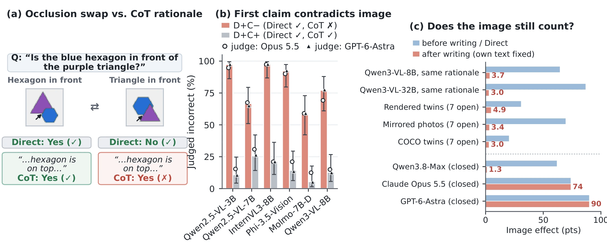
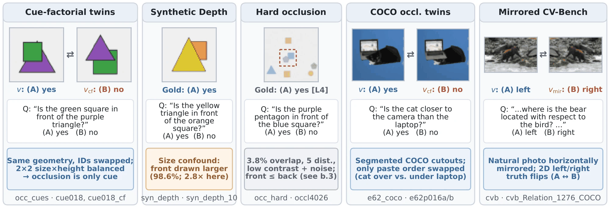

# Seeing Right, Writing Wrong

<div align="center">

**Where Short Chain-of-Thought Breaks Spatial VQA**

<p align="center">
  <a href="https://ming-zch.github.io/seeing-right-writing-wrong/assets/paper.pdf">
    
  </a>
  <a href="https://ming-zch.github.io/seeing-right-writing-wrong/">
    
  </a>
  <a href="LICENSE">
    
  </a>
</p>


</div>

---

## 🔥News

- **[Nov. 2026]**: Our paper is available as a [PDF](https://ming-zch.github.io/seeing-right-writing-wrong/assets/paper.pdf) on the project page and has been submitted to arXiv, check it out!
- **[Nov. 2026]**: All our datasets and code are open-sourced, including prompts and per-item model outputs!

## ✨ Highlights

- 🔍 **Broad study**: 15 open VLMs (2B–38B) and 6 frontier closed models on binary depth and spatial questions. Short CoT significantly lowers accuracy in 6 of 8 main-pool open models, and rationale length, turn format and visual forgetting do not explain the drop.
- ✍️ **Writing re-weights visual cues**: 56.6% of the Direct-right, CoT-wrong losses on three occlusion sets end in a false written spatial relation.
- 🔒 **Text lock-in**: with the model's own conclusion-removed rationale held fixed, mirroring the photo moves the answer by only 3.4 pts, compared with 69.6 pts under Direct answering (7-model mean).
- 🔁 **Conclusions mis-map true relations**: 23.8% of these losses write a true relation and then pick the wrong option, mostly on converse questions (29.5% error vs. 2.4% on restatements).
- 📈 **When CoT helps**: the accuracy of the written relation relative to Direct tracks the net CoT effect (r = 0.93 across 21 model-by-dataset cells).
- 🧭 **Re-grounding**: 3 of 6 closed models re-check the image after writing (the three that lock in were queried with reasoning off), and a LoRA pilot suggests that answer-step re-grounding is learnable.

## 📋 Table of Contents

- [Introduction](#introduction)
- [Method](#method)
- [Getting Started](#getting-started)
  - [Installation](#installation)
  - [Repository Layout](#repository-layout)
  - [Data](#data)
  - [Running the Experiments](#running-the-experiments)
  - [Model Outputs](#model-outputs)
  - [Code Map](#code-map)
- [Citation](#citation)
- [Acknowledgments](#acknowledgments)

## Introduction

Asking a vision-language model (VLM) to think step by step often lowers its accuracy on spatial questions, even though the image stays in context. We show that short chain-of-thought (CoT) turns spatial VQA from a perception problem into a transcription problem: once a VLM writes a spatial relation, its answer follows that sentence rather than the image. The failure has three stages. (1) Writing re-weights visual cues and often yields a false relation. (2) Text lock-in: with the model's own conclusion-removed rationale fixed, swapping the image barely moves the answer. (3) Concluding sentences mis-map even true relations, mainly on converse questions. How accurate the written relation is compared with Direct answering accounts for when CoT helps and when it hurts.

<p align="center">
  
</p>

*(a) On occlusion twins, Direct answers flip with the image, while short CoT writes the same false relation for both images. (b) On Direct-right, CoT-wrong items, judges mark the first spatial claim as contradicting the image far more often than on items CoT gets right. (c) After writing, the image barely affects open models' answers, while some closed models re-check it.*

## Method

The analysis protocol measures where in the rationale the answer stops depending on the image.

- **Forced readout.** We read the higher-probability option letter at the assistant prefix `Answer: (`, either right after the question (**Direct**) or after a greedy step-by-step rationale (**CoT**). The same readout can be taken after every rationale sentence.
- **Conclusion-removed rationale (R<sub>cut</sub>).** The model's own rationale with its concluding answer sentence removed, so that only the body claims remain.
- **Image swaps.** Paired images that flip the correct answer and change nothing else: rendered **occlusion twins** (only the object in front changes), **COCO occlusion twins** (segmented natural objects with swapped paste order), and **mirrored photos** (horizontally flipped CV-Bench images for left/right questions). The **image effect** is the change in answer probability when the image is swapped while R<sub>cut</sub> stays fixed (100 pts: the answer follows the image; 0 pts: the image is ignored).
- **Commit sentence j\*.** The rationale sentence at which the forced-readout probability of the correct option drops below 0.5 and stays there until the end of the rationale.
- **Sentence judges.** Two LLM judges (Claude Opus 5.5 and GPT-6-Astra) label the spatial relation in each sentence as true or false, which separates false written relations from correct relations mapped to the wrong option.

<p align="center">
  
</p>

*(a) The forced readout stays high until the commit sentence j\* and then drops. (b) Most commit sentences state a spatial relation. (c) CoT changes how much the final answer relies on occlusion.*

## Getting Started

### Installation

```bash
git clone https://github.com/MING-ZCH/seeing-right-writing-wrong.git
cd seeing-right-writing-wrong
python3.11 -m venv .venv && source .venv/bin/activate
pip install -r requirements.txt     # CPU: data builders, LLM judges, CPU analysis steps
source env.example.sh               # VTAX_ROOT, VTAX_DATA_ROOT, PYTHONPATH, API endpoint
```

The GPU runners need one of two pinned environments: `bash requirements/setup_envs.sh main` (Qwen2.5-VL, InternVL3, Phi-3.5-Vision, Molmo; PyTorch 2.6.0, Transformers 4.51.3) or `bash requirements/setup_envs.sh qwen3vl` (Qwen3-VL, InternVL3.5; PyTorch 2.8.0, Transformers 4.57.1). Add `WITH_VLLM=1` to install the pinned vLLM version (0.8.4 or 0.11.0). Runs used bfloat16 and greedy decoding; the engine settings are in `srww/vllm_utils.py` (`make_llm`).

### Repository Layout

```
seeing-right-writing-wrong/
├── srww/               # core library
│   ├── protocol.py     #   prompts, conditions, filler text, data loaders and top-20 readout of the original runs
│   ├── vllm_utils.py   #   vLLM engines, exact full-vocabulary readout at "Answer: (", rationale generation
│   ├── rcut.py         #   rationale truncation: R_cut and conclusion removal
│   ├── claim_parse.py  #   sentence split, sentence types, written-relation parsers
│   ├── records.py      #   readers for per-item readout records
│   ├── cue_glm.py      #   probit GLM of the cue-factorial answers
│   ├── common.py       #   item / prompt types, cluster bootstrap and sign-flip tests, HF model adapters
│   ├── api_client.py   #   client for an OpenAI-compatible chat-completions endpoint
│   └── paths.py        #   all paths, derived from VTAX_ROOT / VTAX_DATA_ROOT
├── data_gen/           # stimulus and item builders
├── experiments/        # runners, grouped by paper section (see Code Map)
├── judges/             # LLM-judge scripts (prompts are defined in each script)
├── data/
│   ├── items/          # synthetic stimuli: occlusion twins, cue-factorial set, hard occlusion set, Synthetic Depth / Relative Position
│   ├── coco_composites/# COCO ids, paste parameters, questions, image sha256 (no images)
│   └── benchmark_ids/  # ids of the public benchmark items used (no benchmark content)
├── requirements/       # pinned GPU environments and setup_envs.sh
├── assets/             # README figures
├── env.example.sh
└── requirements.txt
```

Run every script from the repository root as a module, e.g. `python -m experiments.occlusion.twins_readout --help`. Outputs are written to `outputs/<experiment id>/`.

### Data

<p align="center">
  
</p>

*Five binary spatial suites: cue-factorial twins, Synthetic Depth, hard occlusion, COCO occlusion twins and mirrored CV-Bench photos.*

- **Synthetic stimuli (included).** `data/items/occlusion/` (200 occlusion twin pairs, 400 images), `data/items/occ_cues/` (cue-factorial set, 800 images) and `data/items/occlusion_hard/` (difficulty-calibrated hard set; items and image sha256 only). Each folder has the item files, a generation report and `images_sha256.json`. Regenerate a set with its builder:
  ```bash
  python -m data_gen.occlusion_twins --out-dir data/items/occlusion
  python -m data_gen.cue_factorial_set --out-dir data/items/occ_cues --n 400
  python -m data_gen.hard_occlusion_set --out-dir data/items/occlusion_hard --n 144 --levels L3,L3b,L4
  ```
- **COCO occlusion twins (rebuild).** The 466 composites contain COCO pixels and are not shipped. Put `annotations/instances_val2017.json` under `$VTAX_DATA_ROOT/datasets/coco2017_val/`, then:
  ```bash
  python -m data_gen.coco_occlusion_twins select     # candidate objects and background crops
  python -m data_gen.coco_occlusion_twins download   # the needed val2017 images
  python -m data_gen.coco_occlusion_twins build      # -> outputs/e62/stimuli/
  # write {"drop_pairs": [...]} with the 7 dropped_pairs of data/coco_composites/manifest.json
  # to outputs/e62/stimuli/handcheck/drop.json, then
  python -m data_gen.coco_occlusion_twins finalize   # items_final.jsonl + manifest.json
  ```
  Compare the result with `data/coco_composites/` (items, pairs and the sha256 of every image).
- **Mirrored CV-Bench items.** `python -m data_gen.mirrored_cvbench build`, the text judge `python -m judges.mirrored_cvbench_judge text --judge <judge>`, then `python -m data_gen.mirrored_cvbench finalize`.
- **Synthetic Depth / Synthetic Relative Position (included).** The two main-pool synthetic sets were generated by our own renderer, `data_gen/synthetic_spatial.py` (500 items each, seed 42; in Synthetic Depth the front shape is drawn last and larger). `data/items/spatial_probing/` holds the item files, the shapes of every depth image, the 750 PNG images (3.5 MB) and their sha256; a fresh run reproduces all of them byte for byte. The vLLM runners read the sets from `$VTAX_DATA_ROOT/datasets/spatial_probing` (absolute image paths): `python -m data_gen.synthetic_spatial`.
- **Public benchmarks (download).** Benchmarks are not redistributed; `data/benchmark_ids/` lists the item ids we used. `python -m data_gen.benchmark_items cvbench --out <dir>/cvbench.jsonl` (and `blink`, or `hf` with a column mapping for 3DSRBench) writes item manifests with PNG images from the Hugging Face releases. Expected locations under `$VTAX_DATA_ROOT/datasets/` for the vLLM runners: `cv_bench/hf_dataset` (CV-Bench test split saved with `datasets.save_to_disk`), `heldout/BLINK/{Spatial_Relation,Relative_Depth}/val-00000-of-00001.parquet` and `heldout/3DSRBench/3dsrbench_v1_vlmevalkit.tsv`. The loaders are `srww/protocol.py` (main pool) and `experiments/behavior/heldout_benchmarks.py` (held-out pool).
- **Models.** Checkpoints are read from `$VTAX_DATA_ROOT/models/<Hugging Face repo name>` (e.g. `Qwen2.5-VL-7B-Instruct`, `Qwen3-VL-8B-Instruct`, `InternVL3_5-8B`, `Molmo-7B-D-0924`); the full list is `MODELS` in `srww/protocol.py` and `srww/vllm_utils.py`.

### Running the Experiments

Closed models and LLM judges use any OpenAI-compatible chat-completions endpoint:

```bash
export OPENAI_COMPAT_BASE_URL="https://<your-endpoint>/v1"
export OPENAI_COMPAT_API_KEY="<your-key>"     # keep it in your shell, never commit it
```

A few commands per section (add `--limit N` for a quick run; every script has `--help`):

```bash
# Behavioral controls on the main pool and the held-out pool (GPU)
python -m experiments.behavior.behavior_factorial --model qwen7b --limit 20
python -m experiments.behavior.exact_readout --model qwen7b --limit 20
python -m experiments.behavior.heldout_benchmarks --model qwen7b --stage direct
python -m experiments.behavior.heldout_predict --models qwen7b       # freeze predictions (data/heldout/gate_frozen_tau.json)
python -m experiments.behavior.heldout_benchmarks --model qwen7b --stage rest

# Occlusion twins and cue-factorial set: Direct / CoT readouts (GPU)
python -m experiments.occlusion.twins_readout --model qwen3vl_8b --limit 5
python -m experiments.interventions.structured_state --model qwen3vl_8b --set cues --limit 5

# Commit onset: forced readout after every rationale sentence (GPU), commit-sentence judge (API)
python -m experiments.commit_onset.sentence_trajectory --model qwen7b --limit 5
python -m judges.commit_sentence_judge --judge claude-opus-5-5

# Fixed-rationale image swaps (GPU)
python -m experiments.fixed_rationale.conclusion_swap --model qwen7b --limit 5
python -m experiments.fixed_rationale.mirrored_cvbench_swap --model qwen7b --limit 3
python -m experiments.fixed_rationale.coco_twins_swap --model qwen3vl_8b --limit 3

# Claim edits and attention knockouts (GPU)
python -m experiments.claim_edits.first_claim_edit --model qwen7b --limit 5 --sets occ --modes inplace
python -m experiments.knockouts.rcut_knockout --model qwen7b --stage sample
python -m experiments.knockouts.rcut_knockout --model qwen7b --stage main --set occ

# Cue analysis and two-channel accounting (CPU, plus text-only judge calls)
python -m experiments.cue_analysis.cue_ame
python -m experiments.two_channel.uniform_two_channel build
python -m experiments.two_channel.uniform_two_channel judge --judge gpt-6-astra
python -m experiments.two_channel.uniform_two_channel analyze
python -m experiments.two_channel.two_channel_fit --only two,acct

# Closed models (API)
python -m experiments.closed_models.occlusion_audit --model gpt-6-astra --items-dir data/items/occlusion_hard --tasks occ --out-dir outputs/e9h --limit 5
python -m experiments.closed_models.image_blind sample
python -m experiments.closed_models.image_blind gen --model gpt-6-astra --limit 5
python -m experiments.closed_models.fixed_rcut build

# Label-free interventions
python -m experiments.interventions.prompt_variants --model qwen3vl_8b --set cues --limit 5
python -m experiments.interventions.body_relation_readout
python -m experiments.interventions.commit_gate --model qwen3vl_8b --set cues --limit 10
python -m experiments.interventions.commit_gate_controls --model qwen3vl_8b --set cues --limit 10

# Linear probes (GPU extraction with HF Transformers, CPU analysis); states go to $VTAX_SCRATCH
python -m experiments.probes.extract_states --model qwen3vl_8b --shard 0 --nshard 1
python -m experiments.probes.extract_image_controls --model qwen3vl_8b --shard 0 --nshard 1
python -m experiments.probes.within_claim_probe --model qwen3vl_8b

# LoRA pilot (Qwen3-VL-8B)
python -m experiments.lora_pilot.stimuli build
python -m experiments.lora_pilot.generate gen --shard 0 --nshard 8
python -m experiments.lora_pilot.generate build
torchrun --nproc_per_node 2 experiments/lora_pilot/train.py train --arm cf
python -m experiments.lora_pilot.evaluate --model qwen3vl_8b_e63cf --sets coco,e60,heldout
```

The activation-steering runs reported with the probe result used two further scripts (direction fitting and steered generation) and are not part of this release. Most analysis steps read the outputs of earlier runs from `outputs/`; unzip the released outputs (below) to start from the paper's runs. Model keys (`qwen3b`, `qwen7b`, `internvl3_8b`, `phi35v`, `molmo7b`, `qwen3vl_8b`, `qwen3vl_8b_think`, `internvl35_8b`, `qwen3vl_32b`, ...) are defined in `srww/protocol.py` and `srww/vllm_utils.py`.

### Model Outputs

Per-item model outputs and judge labels are available as a release asset: [srww_outputs_v1.zip](https://github.com/MING-ZCH/seeing-right-writing-wrong/releases/tag/v1.0). Unzip it in the repository root to get `outputs/` (one folder per experiment id, plain JSON / JSONL, aggregated results in `outputs/bundle/`); `outputs/README.txt` describes each folder. The outputs include text generated by the evaluated open and closed models; closed models are referred to by their API model ids.

### Code Map

Experiment ids match the output folders in `outputs/`.

| Module | Id | What it does |
|---|---|---|
| `experiments/behavior/behavior_factorial.py` | e1 | main pool: greedy CoT, forced readout under all conditions (Direct, CoT, filler, turn) |
| `experiments/behavior/conclusion_edit.py` | e5 | R<sub>cut</sub> and appended conclusion swaps |
| `experiments/behavior/exact_readout.py` | e1x | exact full-vocabulary readout of the stored main-pool rationales |
| `experiments/behavior/qwen3vl_main_pool.py` | e4 | Qwen3-VL / InternVL3.5 main-pool runs (vLLM V1) |
| `experiments/behavior/rationale_ablation.py` | e2a | rationales regenerated under image ablations |
| `experiments/behavior/reasoning_formats.py` | e5x | question-blind description and other zero-training formats |
| `experiments/behavior/heldout_benchmarks.py`, `heldout_evaluate.py` | e6x, e6 | held-out pool (BLINK, 3DSRBench) under the frozen protocol |
| `experiments/behavior/heldout_predict.py` | e6 | pre-registered held-out predictions from Direct outputs and the frozen gate |
| `experiments/occlusion/twins_readout.py`, `twins_readout_thinking.py` | e2d | occlusion twins: Direct / CoT readouts, both phrasings |
| `experiments/occlusion/thinking_description.py` | e31 | Qwen3-VL-8B-Thinking: description arm on the cue set |
| `experiments/occlusion/reasoning_models.py` | e48 | MiMo-VL-7B-RL, GLM-4.1V-9B-Thinking |
| `experiments/cue_analysis/cue_ame.py` | r18 | cue AMEs (occlusion, height, size) of Direct and CoT answers |
| `experiments/cue_analysis/cue_congruence.py` | e13 | cue-congruence cells, d′ per cell |
| `experiments/commit_onset/sentence_trajectory.py` | e2b | forced readout after every rationale sentence |
| `experiments/commit_onset/prefix_trajectory.py`, `dc_groups.py` | e2b | HF-adapter variant with sentence typing |
| `experiments/commit_onset/cue_set_pipeline.py` | e28 | sentence-level pipeline on the cue set |
| `experiments/commit_onset/qwen3vl_32b_pipeline.py` | e57 | sentence-level pipeline on Qwen3-VL-32B |
| `experiments/fixed_rationale/conclusion_swap.py` | e3x | fixed rationale (R, R<sub>cut</sub>), rendered twin swap |
| `experiments/fixed_rationale/mirrored_cvbench_swap.py` | e60 | fixed rationale, mirrored CV-Bench photo |
| `experiments/fixed_rationale/coco_twins_swap.py` | e62 | Direct, CoT and fixed-rationale swap on COCO twins |
| `experiments/claim_edits/first_claim_edit.py` | e2f | replace the first written claim (true / false / neutral) |
| `experiments/claim_edits/commit_claim_edit.py` | e29 | claim edits at the commit sentence |
| `experiments/claim_edits/argument_order_edit.py` | e30 | argument-order edits, gray-image prefix readout |
| `experiments/knockouts/attention_knockout.py` | e52 | attention-edge knockouts at the answer position |
| `experiments/knockouts/rcut_knockout.py` | e59 | knockouts on R<sub>cut</sub>, seven open models |
| `experiments/two_channel/two_channel_fit.py` | e32, e36 | two-channel fit and accounting on the synthetic sets |
| `experiments/two_channel/natural_two_channel.py` | e35 | out-of-sample test on natural depth items |
| `experiments/two_channel/uniform_two_channel.py`, `uniform_analysis.py` | e45 | two-channel analysis under one conclusion-removal protocol |
| `experiments/closed_models/occlusion_audit.py` | e9x, e9h | closed models: Direct and CoT answers |
| `experiments/closed_models/image_blind.py`, `image_blind_analysis.py` | e50 | closed models under the real, a gray and the twin image |
| `experiments/closed_models/fixed_rcut.py` | e61 | closed models with their own R<sub>cut</sub> fixed |
| `experiments/interventions/structured_state.py` | e10 | structured grounded-state condition; cue-set readouts |
| `experiments/interventions/prompt_variants.py` | e44 | label-free CoT prefix variants |
| `experiments/interventions/body_relation_readout.py` | e58 | label-free readout of the written body relation |
| `experiments/interventions/commit_gate.py` | e22 | commit-sentence gate vs. plain CoT, random-resample and text-gate controls |
| `experiments/interventions/commit_gate_controls.py` | e22b | location-, count- and criterion-matched controls for the gate |
| `experiments/probes/extract_states.py` | e15 | residual-stream states at the Direct, claim, answer and filler tokens (HF forward) |
| `experiments/probes/extract_image_controls.py`, `claim_spans.py` | e17 | states with the CoT text fixed under the original, gray and twin image |
| `experiments/probes/within_claim_probe.py` | e17 | within-claim linear probe of the true depth order, gray refit, twin transfer |
| `experiments/lora_pilot/*.py` | e63 | LoRA pilot: stimuli, rationales, training, evaluation |
| `data_gen/occlusion_twins.py`, `cue_factorial_set.py`, `hard_occlusion_set.py` | | rendered stimulus sets |
| `data_gen/benchmark_items.py` | | item manifests from CV-Bench, BLINK and other Hugging Face benchmarks |
| `data_gen/synthetic_spatial.py` | | Synthetic Depth Ordering and Synthetic Relative Position sets (main pool) |
| `data_gen/mirrored_cvbench.py`, `coco_occlusion_twins.py` | e60, e62 | natural-image twin items |
| `judges/occlusion_claim_judge.py`, `occlusion_claim_judge2.py` | e2 | first-claim audit with the image |
| `judges/cue_claim_judge.py` | e16 | text-only first-claim parse on the cue set |
| `judges/commit_sentence_judge.py`, `cue_commit_judge.py` | e20, e28 | commit sentence j\* against the image |
| `judges/claim_edit_judge.py`, `cue_audit_judge.py` | e29, e30 | judge calls of the claim-edit runs |
| `judges/closed_relation_judge.py` | e38 | last written relation in closed-model CoT |
| `judges/reasoning_relation_judge.py` | e48 | written relation, reasoning models |
| `judges/closed_image_blind_judge.py` | e50 | written relation and image presence, closed models |
| `judges/decomposition_judge.py` | e54 | subtypes of Direct-right, CoT-wrong losses |
| `judges/qwen3vl_32b_judge.py` | e57 | judge calls of the Qwen3-VL-32B pipeline |
| `judges/mirrored_cvbench_judge.py`, `coco_twins_judge.py` | e60, e62 | item filters and relation labels |

## Citation

If you find this work helpful, please cite:

```bibtex
@article{zhang2026seeing,
  title   = {Seeing Right, Writing Wrong: Where Short Chain-of-Thought Breaks Spatial {VQA}},
  author  = {Zhang, Chenhao},
  journal = {arXiv preprint},
  year    = {2026}
}
```

## License

The code in this repository is released under the [MIT License](LICENSE). Benchmark data, COCO images and model checkpoints are not included and remain under their own licences (COCO annotations: CC BY 4.0; images: licences of their Flickr owners).

## Acknowledgments

This work builds on public benchmarks and open models. We thank the authors of:

- **Benchmarks and data**: [CV-Bench](https://github.com/cambrian-mllm/cambrian), [BLINK](https://github.com/zeyofu/BLINK_Benchmark), [3DSRBench](https://3dsrbench.github.io/), [VSI-Bench](https://github.com/vision-x-nyu/thinking-in-space), [MindCube](https://github.com/mll-lab-nu/MindCube), and [COCO](https://cocodataset.org/).
- **Open models**: [Qwen2.5-VL and Qwen3-VL](https://github.com/QwenLM), [InternVL3 and InternVL3.5](https://github.com/OpenGVLab/InternVL), [Molmo](https://github.com/allenai/molmo), [Phi-3.5-Vision](https://huggingface.co/microsoft/Phi-3.5-vision-instruct), [MiMo-VL](https://github.com/XiaomiMiMo/MiMo-VL), and [GLM-4.1V-Thinking](https://github.com/THUDM/GLM-4.1V-Thinking).
- **Inference**: [vLLM](https://github.com/vllm-project/vllm) and [Hugging Face Transformers](https://github.com/huggingface/transformers).

## Contact

For questions or issues, please open an issue on GitHub or contact [MING-ZCH](https://github.com/MING-ZCH).
